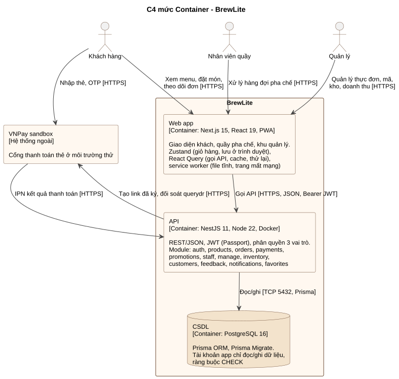

# Kiến trúc BrewLite (Task 3.1)

| Phiên bản | Ngày | Nội dung |
|---|---|---|
| 1.0 | 14/11/2026 | Bản đầu, mô tả kiến trúc đang chạy trên production |

Tài liệu liên quan: [SRS](../requirements/srs.md) · [Sơ đồ triển khai và cách triển khai](../deployment.md) · [Quyết định kiến trúc (ADR)](adr/)

## 1. Tổng quan

BrewLite dùng **kiến trúc phân lớp, tách frontend và backend**, trình bày theo **mô hình C4** ở mức Context và Container:

- **Web app** (Next.js, PWA) chỉ lo giao diện, không chứa luật nghiệp vụ quan trọng.
- **API** (NestJS) giữ toàn bộ luật nghiệp vụ: tính giá, tồn kho, máy trạng thái đơn, thanh toán, phân quyền.
- **CSDL** (PostgreSQL) là nguồn dữ liệu duy nhất, tự bảo vệ bằng ràng buộc.
- **VNPay sandbox** là dịch vụ thanh toán bên ngoài, chạy ở môi trường thử.

Nguyên tắc chính: **không tin trình duyệt**. Giá, giảm giá, tồn kho, trạng thái thanh toán đều do API tính lại từ CSDL hoặc xác minh bằng chữ ký; dữ liệu trình duyệt gửi lên chỉ là lựa chọn của khách.

### 1.1 C4 mức Context

| Người/hệ thống | Tương tác với BrewLite |
|---|---|
| Khách hàng | Xem menu, đặt món, thanh toán, theo dõi đơn, điểm thưởng |
| Nhân viên quầy | Nhận đơn đã thanh toán, chuyển bước pha chế, huỷ đơn chưa pha |
| Quản lý | Doanh thu, thực đơn và giá, mã giảm giá, kho, tài khoản khách, phản hồi |
| VNPay sandbox | Nhận khách sang trang thanh toán; báo kết quả qua Return URL và IPN; trả lời đối soát |

### 1.2 C4 mức Container

Nguồn PlantUML: [c4-container.puml](c4-container.puml)

| Container | Công nghệ | Trách nhiệm | Mã nguồn |
|---|---|---|---|
| Web app | Next.js 15 (App Router), React 19, TypeScript, TailwindCSS 4, Zustand, React Query | Giao diện mobile-first cho 3 vai trò; giỏ hàng lưu ở trình duyệt; gọi API; PWA | `apps/web` |
| API | NestJS 11, Node 22, Passport JWT, class-validator, Prisma Client | REST API, nghiệp vụ, phân quyền, tích hợp VNPay, tác vụ nền | `apps/api` |
| CSDL | PostgreSQL 16 | Lưu trữ bền vững; ràng buộc CHECK; tài khoản app hạn chế quyền | `apps/api/prisma` |

## 2. Frontend Next.js / PWA

| Lớp | Vai trò | Vị trí |
|---|---|---|
| Trang (route) | Mỗi URL một trang: khách (`/`, `/menu`, `/checkout`, `/orders`…), quầy (`/staff`), quản lý (`/quan-ly/*`) | `apps/web/app` |
| Component | Giao diện theo khu vực: menu, sản phẩm, checkout, orders, staff, manager | `apps/web/components` |
| Trạng thái | Zustand: giỏ hàng, lưu `localStorage`; context đăng nhập | `apps/web/context` |
| Truy cập dữ liệu | `apiRequest` đổi mọi lỗi thành câu tiếng Việt; hook React Query cho từng loại dữ liệu (tự cache, thử lại, làm mới định kỳ) | `apps/web/lib` |
| PWA | Manifest, icon, service worker (chỉ lưu file tĩnh và trang mất mạng) | `apps/web/app/manifest.ts`, `apps/web/public/sw.js` |

Trang được dựng trên máy chủ Vercel (tải nhanh lần đầu), phần tương tác chạy trên trình duyệt. Địa chỉ API đọc từ `NEXT_PUBLIC_API_URL` lúc build.

## 3. Backend NestJS theo module

Mỗi miền nghiệp vụ là một module NestJS (controller → service → Prisma), phụ thuộc một chiều:

| Module | Trách nhiệm | Phụ thuộc |
|---|---|---|
| `auth` | Đăng ký, đăng nhập JWT, guard vai trò, đổi mật khẩu, điểm, đổi quà | prisma |
| `products` | `GET /products`, `GET /products/:id` | prisma; hàm tính kho của inventory |
| `promotions` | Luật mã giảm giá (hàm thuần, dễ test) | prisma |
| `orders` | Báo giá, tạo đơn, máy trạng thái, giữ tồn kho, huỷ, tự huỷ đơn bỏ dở, trừ nguyên liệu khi pha | prisma, promotions; hàm kho của inventory |
| `payments` | Thanh toán idempotent; VNPay: ký link, Return URL, IPN, đối soát; trả bằng điểm | prisma; `VnpayGateway` (cấu hình đọc từ biến môi trường) |
| `staff` | Hàng đợi quầy, chuyển bước, huỷ đơn đã thanh toán | orders |
| `manage` | Tổng quan doanh thu, thực đơn, mã giảm giá, nội dung trang | prisma |
| `inventory` | Nguyên liệu, phiếu nhập, công thức, trừ kho khi pha | prisma |
| `customers`, `feedback`, `notifications`, `favorites` | Tài khoản khách, phản hồi, thông báo, món yêu thích | prisma |
| `prisma` | Kết nối CSDL dùng chung (module toàn cục) | — |

Luật nghiệp vụ quan trọng viết thành **hàm thuần** tách khỏi CSDL để unit test: `orders/order-state-machine.ts`, `orders/pricing.ts`, `promotions/voucher-rules.ts`, `payments/vnpay/vnpay.util.ts`, `inventory/usage.ts`.

Các lớp bảo vệ dùng chung ở `main.ts`, `app.module.ts`: `ValidationPipe` (whitelist, từ chối trường lạ), `helmet`, CORS theo `FRONTEND_URL`, giới hạn request theo IP (`@nestjs/throttler`), `trust proxy` khi chạy sau proxy.

## 4. PostgreSQL và migration

- Lược đồ khai báo ở `apps/api/prisma/schema.prisma`; mỗi thay đổi là một thư mục trong `prisma/migrations/`, có phiên bản trong Git.
- `npm run db:migrate` chạy `prisma migrate deploy`: chỉ áp migration chưa chạy, không xoá dữ liệu. CSDL cũ tạo bằng `db push` được tự baseline.
- CI kiểm tra `schema.prisma` khớp thư mục migration; sửa schema mà quên tạo migration thì CI đỏ.
- `db-harden`: tạo tài khoản app chỉ có SELECT/INSERT/UPDATE/DELETE, gắn ràng buộc CHECK (tồn kho, điểm, tiền không âm…). Migration và harden chạy bằng tài khoản chủ (`DIRECT_URL`), API chạy bằng tài khoản app (`DATABASE_URL`).
- Tính đúng khi đồng thời: tồn kho dùng optimistic locking (cột `version`), thanh toán khoá dòng đơn (`SELECT … FOR UPDATE`), Idempotency-Key là cột UNIQUE.

## 5. Dịch vụ thanh toán mô phỏng

Đề yêu cầu "Ví/Thẻ mô phỏng":

- **Thẻ** là **VNPay sandbox**, môi trường thử của cổng thanh toán thật: tích hợp đúng chuẩn (ký HMAC-SHA512, Return URL, IPN, đối soát `querydr`) nhưng không có tiền thật. Mã nguồn tách riêng ở `apps/api/src/payments/vnpay/`; gateway nhận cấu hình qua tham số nên integration test thay VNPay bằng tham số ký đúng, không cần gọi mạng.
- **Ví** là **điểm BrewLite**, trừ trong một transaction.

Kết quả thanh toán từ Return URL, IPN hay đối soát đều đi qua một hàm ghi nhận duy nhất, kiểm chữ ký và số tiền, ghi đúng một lần. Mọi trao đổi với VNPay lưu ở bảng `PaymentLog`.

## 6. Logging, health check, cấu hình

| Mối quan tâm | Cách làm |
|---|---|
| Logging | Logger của NestJS: log khởi động, lỗi 5xx, tác vụ nền (tự huỷ đơn). Nghiệp vụ thanh toán ghi `PaymentLog`, khoá tài khoản ghi `AccountLog`. Xem log trên Render (*Logs*) và Vercel (*Deployments*) |
| Health check | `GET /health` chạy `SELECT 1`: 200 khi CSDL kết nối được, 503 khi mất kết nối. Render dùng làm health check; smoke test gọi sau mỗi lần deploy |
| Cấu hình | Biến môi trường, `@nestjs/config`. Mẫu ở `apps/api/.env.example`, `apps/web/.env.example`, `.env.example`. Ở production, secret nằm ở Render, Vercel và GitHub Secrets; API không khởi động nếu `JWT_SECRET` yếu |
| Tác vụ nền | `setInterval` trong `OrdersService` mỗi phút tự huỷ đơn bỏ dở |

## 7. Lý do lựa chọn, ưu điểm, hạn chế, trade-off

| Quyết định | Ưu điểm | Hạn chế, trade-off | ADR |
|---|---|---|---|
| Monorepo `apps/web`, `apps/api` | Một PR thay đổi được cả hai phía; CI/CD và tài liệu một chỗ | Hai bộ `package.json` riêng, cài thư viện hai lần | [001](adr/001-monorepo.md) |
| Frontend và backend tách, giao tiếp REST | Luật nghiệp vụ nằm một chỗ ở API; frontend đổi giao diện không đụng nghiệp vụ | Thêm một lần gọi mạng; phải cấu hình CORS, địa chỉ API | [002](adr/002-next-pwa-frontend.md), [003](adr/003-nestjs-module-backend.md) |
| NestJS chia module theo miền | Ranh giới rõ, dễ chia việc, dễ test | Nhiều file khung (module, controller, service) | [003](adr/003-nestjs-module-backend.md) |
| PostgreSQL, Prisma, Prisma Migrate | Transaction, khoá dòng, ràng buộc CHECK; migration có phiên bản | Câu lệnh đặc thù (khoá dòng, CHECK) phải viết SQL thô | [004](adr/004-postgresql-prisma-migrate.md) |
| VNPay sandbox thay cổng giả tự viết | Đúng chuẩn tích hợp thật, demo trên trang VNPay thật | Phụ thuộc dịch vụ ngoài; IPN cần địa chỉ công khai | [005](adr/005-vnpay-sandbox.md) |
| Idempotency-Key, optimistic locking | Không trừ tiền hai lần, không bán vượt kho khi đồng thời | Phải thử lại khi xung đột; logic phức tạp hơn | [006](adr/006-idempotency-va-khoa-lac-quan.md) |
| Vercel (web), Render (API, CSDL), GHCR | Miễn phí, HTTPS sẵn, CSDL có mạng nội bộ | Gói miễn phí ngủ khi vắng khách; CSDL Free hết hạn sau 30 ngày | [007](adr/007-trien-khai-vercel-render.md) |
| GitHub Actions cho CI/CD | Cùng chỗ với mã nguồn và PR; chặn merge khi CI đỏ | Phụ thuộc runner của GitHub (từng gặp lỗi tải font khi build) | [008](adr/008-ci-cd-github-actions.md) |
