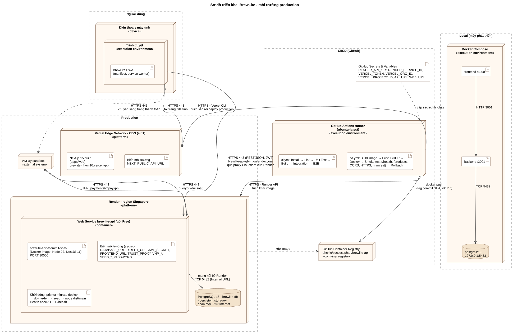

# Triển khai production BrewLite

Tài liệu này mô tả môi trường production, pipeline CI/CD, cách cài đặt lần đầu và cách rollback (Task 5.3, 5.4).

## 1. Môi trường production

| Thành phần | Nền tảng | Địa chỉ | Ghi chú |
|---|---|---|---|
| Frontend Next.js (PWA) | **Vercel** (CDN toàn cầu, edge Singapore) | https://brewlite-nhom10.vercel.app | HTTPS tự cấp. Chỉ pipeline CD được deploy (`apps/web/vercel.json` tắt deploy tự động theo Git) |
| Backend NestJS | **Render** Web Service (Singapore), chạy Docker image | https://brewlite-api-gb4h.onrender.com | Image lấy từ GitHub Container Registry (GHCR). Health check `GET /health` |
| PostgreSQL 16 | **Render** PostgreSQL | Chỉ địa chỉ nội bộ | Ổ đĩa lưu trữ bền vững. Chặn kết nối từ ngoài (Access Control rỗng), API kết nối qua mạng nội bộ của Render |
| Container registry | **GHCR** | `ghcr.io/successphan/brewlite-api:<commit-sha>` | Mỗi commit một tag SHA; tạo tag `vX.Y.Z` thì thêm tag phiên bản |
| Cổng thanh toán | **VNPay sandbox** | `https://sandbox.vnpayment.vn` | Môi trường thử, không tiền thật. IPN gọi về API production |

### Sơ đồ triển khai



Nguồn PlantUML: [architecture/deployment-diagram.puml](architecture/deployment-diagram.puml). Xuất lại ảnh: `java -jar plantuml.jar -tsvg docs/architecture/deployment-diagram.puml` (cần Graphviz).

Mỗi node trong sơ đồ ứng với một thành phần trong mã nguồn hoặc cấu hình:

| Node trong sơ đồ | Mã nguồn, cấu hình |
|---|---|
| Điện thoại / máy tính – Trình duyệt chạy BrewLite PWA | `apps/web/app/manifest.ts`, `apps/web/public/sw.js`, `apps/web/components/layout/ServiceWorkerRegister.tsx` |
| Vercel – CDN: Web Next.js | `apps/web/` (Root Directory của project Vercel), `apps/web/vercel.json`; biến `NEXT_PUBLIC_API_URL` đọc ở `apps/web/lib/api.ts` |
| Render – Web Service brewlite-api (image `brewlite-api:<commit-sha>`) | `apps/api/Dockerfile` (lệnh khởi động: migrate → db-harden → seed → API), `apps/api/src/main.ts` (đọc `PORT`, `TRUST_PROXY`, `FRONTEND_URL`) |
| Health check `/health` (chú thích) | `apps/api/src/app.controller.ts` (trả 503 khi mất CSDL) |
| PostgreSQL 16 (persistent storage) | `apps/api/prisma/schema.prisma`, `apps/api/prisma/migrations/`, `apps/api/src/db-migrate.ts`, `apps/api/src/db-harden.ts` |
| VNPay sandbox (IPN, querydr) | `apps/api/src/payments/vnpay/`, `apps/api/src/payments/payments.controller.ts` |
| GitHub Actions (ci.yml · cd.yml) | `.github/workflows/ci.yml`, `.github/workflows/cd.yml`, `scripts/smoke-test.sh` |
| GitHub Container Registry | bước *Build và push Docker image* trong `cd.yml` |
| Secret, cấu hình (chú thích) | GitHub Secrets; biến môi trường trên Render, Vercel; mẫu ở `apps/api/.env.example`, `apps/web/.env.example` |
| Local – Docker Compose | `docker-compose.yml`, `run-brewlite.bat` |

Ranh giới môi trường:

| | Local | CI (GitHub Actions) | Production |
|---|---|---|---|
| Chạy bằng | `docker compose up` hoặc `run-brewlite.bat` | Runner Ubuntu, PostgreSQL service tạm | Vercel + Render |
| CSDL | Container `db`, cổng `127.0.0.1:5433` | Container tạm, xoá sau mỗi lần chạy | Render PostgreSQL, giữ dữ liệu |
| Secret | `apps/api/.env`, `.env` (không commit) | Giá trị giả trong `ci.yml` | GitHub Secrets, biến môi trường Render/Vercel |
| VNPay | Sandbox, Return URL `localhost` | Giả lập bằng tham số ký đúng | Sandbox, Return URL và IPN là tên miền thật |

## 2. Pipeline

### CI: `.github/workflows/ci.yml`

Chạy khi mở hoặc cập nhật pull request. Nếu có bước lỗi thì CI đỏ và PR không merge được (cần bật *Require status checks*, mục 3.7).

| Job | Các bước |
|---|---|
| Backend (NestJS) | Install → Lint → Unit test → Build → kiểm tra schema khớp migration → áp migration → Integration test (PostgreSQL thật) |
| Frontend (Next.js) | Install → Lint → kiểm kiểu → Unit test (component) → Build |
| E2E (Playwright) | Chạy sau khi hai job trên đạt: build API và web, chạy Playwright từ menu đến màn hình xác nhận và kiểm tra PWA |

### CD: `.github/workflows/cd.yml`

Chạy khi merge vào `main`, khi tạo tag `vX.Y.Z`, hoặc khi chạy tay (dùng để rollback).

```
Push/Tag → Lint và Test → Build Docker image → Push GHCR → Deploy API (Render) → Deploy web (Vercel) → Smoke test → (Release)
                                                               └────────── lỗi ──────────┴──────▶ Rollback
```

1. **Lint và Test**: gọi lại toàn bộ `ci.yml`. Có lỗi thì dừng, không build image.
2. **Build và push Docker image**: image `apps/api` gắn tag commit SHA (và `vX.Y.Z` khi tạo tag), đẩy lên GHCR. Nếu image của commit đó đã có (khi rollback) thì dùng lại, không build lại.
3. **Deploy API**: gọi Render API, triển khai đúng image vừa đẩy, rồi chờ Render báo `live`. Container khi khởi động sẽ:
   - chạy `prisma migrate deploy`: chỉ áp migration mới, không xoá dữ liệu;
   - rào CSDL;
   - seed (chỉ thêm dữ liệu còn thiếu);
   - chạy API.

   Render chỉ chuyển lưu lượng sang bản mới khi `/health` trả 200. Nếu migration lỗi hoặc API không lên, **bản cũ vẫn phục vụ** và job báo lỗi.
4. **Deploy web**: dùng Vercel CLI (`vercel pull` → `vercel build` → `vercel deploy --prebuilt --prod`) với token lưu trong GitHub Secrets.
5. **Smoke test** (`scripts/smoke-test.sh`) kiểm tra:
   - `/health` trả `db: up`;
   - `/products` có món;
   - CORS cho đúng tên miền web;
   - `POST /orders` không token trả 401;
   - web chạy HTTPS, trang chủ, `/menu` và manifest PWA tải được.
6. **Rollback tự động**: deploy hoặc smoke test lỗi khi merge vào `main` thì pipeline đỏ và tự triển khai lại commit `main` trước đó (image cũ trên GHCR, web build lại từ commit cũ), rồi smoke test lại.
7. **GitHub Release**: khi tạo tag `vX.Y.Z` và smoke test đạt, tạo Release với nội dung lấy từ `docs/releases/vX.Y.Z.md`; không có file thì tự sinh từ các PR đã merge.

Secret không xuất hiện trong repo hay log CI: GitHub tự che giá trị secret trong log, còn script không in token.

## 3. Cài đặt lần đầu

Làm theo đúng thứ tự. Các bước 2–6 dùng tài khoản của chủ repo.

### 3.1 Đẩy image đầu tiên

Merge các PR vào `main`. CD chạy *Lint và Test* rồi *Build và push Docker image*. Vì chưa có biến `API_URL`, `WEB_URL`, các bước deploy được **bỏ qua**, pipeline vẫn xanh.

Sau đó mở GitHub → trang cá nhân → **Packages** → `brewlite-api` → **Package settings** → **Change visibility → Public**, để Render kéo được image mà không cần mật khẩu.

Không muốn để public thì: trên Render, *Registry Credentials* → thêm GitHub token có quyền `read:packages`.

### 3.2 Tạo PostgreSQL trên Render

1. https://dashboard.render.com → **New → Postgres**.
2. Đặt tên `brewlite-db`, region **Singapore**, PostgreSQL 16, gói **Free**.
3. Tạo xong, vào tab **Info**:
   - **Access Control**: xoá hết dòng IP, để không máy nào ngoài Render kết nối thẳng được;
   - chép **Internal Database URL**.

> Gói Free của Render PostgreSQL hết hạn sau 30 ngày. Nên tạo gần ngày nộp bài, hoặc nâng gói nếu cần giữ lâu hơn.

### 3.3 Tạo Web Service cho API trên Render

1. **New → Web Service → Existing Image**.
2. Image URL: `ghcr.io/successphan/brewlite-api:<commit-sha>`. Lấy SHA ở log job *Build và push Docker image*, hoặc ở trang Packages.
3. Tên `brewlite-api`, region **Singapore** (cùng region với CSDL), gói **Free**.
4. **Advanced → Health Check Path**: `/health`.
5. **Environment Variables**:

| Biến | Giá trị |
|---|---|
| `DIRECT_URL` | Internal Database URL ở bước 3.2 |
| `DATABASE_URL` | Internal Database URL ở bước 3.2 (xem ghi chú bên dưới) |
| `JWT_SECRET` | Chuỗi ngẫu nhiên ≥ 32 ký tự: `node -e "console.log(require('crypto').randomBytes(48).toString('base64url'))"` |
| `FRONTEND_URL` | `https://<project>.vercel.app` (điền sau bước 3.4) |
| `TRUST_PROXY` | `1` |
| `VNP_TMN_CODE`, `VNP_HASH_SECRET` | Mã VNPay sandbox |
| `VNP_RETURN_URL` | `https://<project>.vercel.app/payment/vnpay-return` |
| `SEED_STAFF_PASSWORD`, `SEED_MANAGER_PASSWORD` | Mật khẩu riêng cho `staff@brewlite.vn`, `manager@brewlite.vn`. Gửi riêng cho giảng viên, không ghi vào repo |

Ghi chú về `DATABASE_URL` (tài khoản app chỉ đọc/ghi): muốn app dùng tài khoản riêng như ở local, đặt `DATABASE_URL` là Internal URL nhưng đổi tên và mật khẩu thành `brewlite_app:<mật-khẩu-mạnh>`; bước rào CSDL sẽ tự tạo tài khoản này. Nếu log báo không có quyền tạo tài khoản, đặt `DATABASE_URL` giống `DIRECT_URL`.

6. Tạo service. Lần deploy đầu sẽ áp migration và nạp dữ liệu mẫu. Khi xong, mở `https://<service>.onrender.com/health` phải thấy `"db":"up"`.
7. Chép **Service ID** (dạng `srv-...`, có trên thanh địa chỉ). Lấy **API Key** ở *Account Settings → API Keys*.

### 3.4 Tạo project Vercel cho web

1. https://vercel.com/new → import repo `brewlite-assignment2`.
2. **Root Directory**: `apps/web`. Framework tự nhận là Next.js.
3. **Environment Variables** (Production): `NEXT_PUBLIC_API_URL` = `https://<service>.onrender.com`. `NEXT_PUBLIC_SHOW_DEMO_HINTS` để trống, hoặc `1` khi demo.
4. Tạo project. Do `vercel.json` đã tắt deploy theo Git, lần deploy đầu sẽ do pipeline làm.
5. Lấy các mã:
   - **Project ID**: *Settings → General*;
   - **Team/Org ID**: *Team Settings → General*, tài khoản cá nhân thì ở *Account Settings*;
   - **Token**: *Account Settings → Tokens*.
6. Quay lại Render, điền `FRONTEND_URL` và `VNP_RETURN_URL` theo tên miền Vercel.

### 3.5 GitHub Secrets và Variables

Repo → **Settings → Secrets and variables → Actions**:

| Loại | Tên | Giá trị |
|---|---|---|
| Secret | `RENDER_API_KEY` | API Key Render |
| Secret | `RENDER_SERVICE_ID` | `srv-...` |
| Secret | `VERCEL_TOKEN` | Token Vercel |
| Secret | `VERCEL_ORG_ID` | Team/Org ID |
| Secret | `VERCEL_PROJECT_ID` | Project ID |
| Variable | `API_URL` | `https://<service>.onrender.com` (không có `/` cuối) |
| Variable | `WEB_URL` | `https://<project>.vercel.app` (không có `/` cuối) |

Sau đó vào **Actions → CD → Run workflow** (để trống ref) để triển khai lần đầu và chạy smoke test.

### 3.6 VNPay IPN

Đăng nhập https://sandbox.vnpayment.vn/merchantv2/ → thông tin website → sửa **IPN URL** thành `https://<service>.onrender.com/payments/vnpay/ipn`.

### 3.7 Bảo vệ nhánh `main`

**Settings → Branches → main**:
- bật *Require a pull request* (1 approval);
- bật *Require status checks to pass*, chọn **Backend (NestJS)**, **Frontend (Next.js)**, **E2E (Playwright)**.

## 4. Phát hành phiên bản

```bash
git checkout main && git pull
git tag v1.0.0
git push origin v1.0.0
```

CD build và deploy đúng commit đó, gắn tag `v1.0.0` cho image, smoke test, rồi tạo GitHub Release. Ghi release notes trước vào `docs/releases/v1.0.0.md` (commit qua PR) để Release dùng nội dung đó.

## 5. Rollback

| Tình huống | Cách làm |
|---|---|
| Deploy hoặc smoke test lỗi sau khi merge `main` | **Tự động**: job *Rollback* triển khai lại commit `main` trước đó và smoke test lại |
| Phát hiện lỗi sau khi đã deploy xong | **Actions → CD → Run workflow**, ô `ref` nhập tag (`v1.0.0`) hoặc SHA của phiên bản tốt. Pipeline dùng lại image cũ trên GHCR, build lại web từ commit đó, smoke test |
| Cần nhanh, không chờ pipeline | Render: *Events* → chọn deploy cũ → **Rollback**. Vercel: *Deployments* → deploy cũ → **Instant Rollback** |

**Lưu ý về migration:** rollback chỉ đưa code về bản cũ, không gỡ migration đã áp. Vì vậy mỗi migration chỉ được **thêm** (thêm bảng, thêm cột có giá trị mặc định hoặc cho phép null), không đổi tên hay xoá cột trong cùng một lần phát hành. Muốn xoá cột thì tách làm hai lần phát hành: lần 1 bỏ code dùng cột, lần 2 mới xoá cột. Như vậy bản cũ vẫn chạy được trên CSDL mới.

## 6. Kiểm tra sau triển khai

```bash
bash scripts/smoke-test.sh https://<service>.onrender.com https://<project>.vercel.app
```

Thêm vài bước kiểm tra bằng tay:
- Cài PWA lên điện thoại (Chrome → *Thêm vào màn hình chính*).
- Đặt một đơn trả bằng VNPay với thẻ test NCB, kiểm tra IPN đã ghi nhận (Lịch sử giao dịch → nhật ký có dòng IPN).
- Thử kết nối thẳng tới PostgreSQL production từ máy ngoài (bằng External URL, nếu có) phải bị từ chối.

## 7. Giới hạn của gói miễn phí

- Render Web Service Free **ngủ sau 15 phút** không có request. Lần gọi đầu mất khoảng 1 phút để thức (smoke test đã tính chờ). Trước buổi demo nên mở `/health` một lần.
- Render PostgreSQL Free hết hạn sau 30 ngày (mục 3.2).
- Log API xem ở Render → *Logs*; log build và deploy web xem ở Vercel → *Deployments*.
