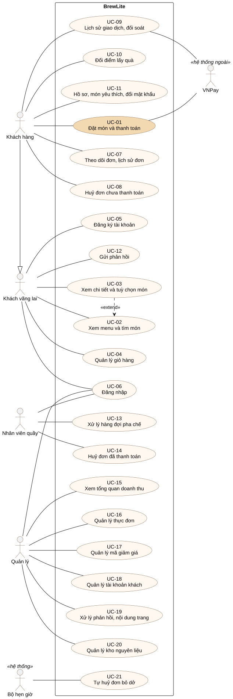

# Đặc tả yêu cầu phần mềm BrewLite (SRS rút gọn, Task 1.2)

| Phiên bản | Ngày | Nội dung |
|---|---|---|
| 1.0 | 14/11/2026 | Bản đầu: 51 yêu cầu chức năng, 25 yêu cầu phi chức năng, sơ đồ use-case tổng quát; đã đối chiếu với mã nguồn và môi trường production |

Tài liệu liên quan: [Bối cảnh và phạm vi](context-and-scope.md) · [Đặc tả UC-01](uc-01-dat-mon-va-thanh-toan.md)

## 1. Giới thiệu

### 1.1 Mục đích

Tài liệu mô tả hệ thống BrewLite **phải làm gì** (yêu cầu chức năng) và **phải đạt chất lượng nào** (yêu cầu phi chức năng). Mỗi yêu cầu có mã, mức ưu tiên MoSCoW và tiêu chí chấp nhận kiểm chứng được, để dùng làm đầu vào cho sơ đồ (Task 2), kiến trúc (Task 3), test và ma trận truy vết (Task 4, 5).

### 1.2 Phạm vi

BrewLite là ứng dụng web mobile-first (PWA) cho một quán cà phê: khách xem menu, tuỳ chỉnh món, đặt đơn, thanh toán không tiền mặt và theo dõi đơn; nhân viên quầy xử lý hàng đợi pha chế; quản lý theo dõi doanh thu, thực đơn, khuyến mãi và kho. Phạm vi chi tiết, giả định, ràng buộc: xem [context-and-scope.md](context-and-scope.md).

### 1.3 Thanh toán "Ví/Thẻ mô phỏng"

Đề yêu cầu thanh toán Ví/Thẻ mô phỏng. BrewLite hiện thực như sau, đều không dùng tiền thật:

| Theo đề | BrewLite | Ghi chú |
|---|---|---|
| Thẻ | Cổng **VNPay sandbox** | Môi trường thử của VNPay, thẻ ATM test do VNPay cấp; tích hợp đúng chuẩn thật (ký HMAC-SHA512, Return URL, IPN, đối soát) |
| Ví | **Điểm BrewLite** | Số dư điểm của tài khoản, 1 điểm = 100đ; trừ trong một transaction |

### 1.4 Thuật ngữ

| Thuật ngữ | Nghĩa |
|---|---|
| Đơn (Order) | Một lần đặt món, mã dạng `BL482913`, có một trong 7 trạng thái ở mục 1.5 |
| Giao dịch (Payment) | Một lần bấm *Thanh toán*; một đơn có thể có nhiều giao dịch (lần trước lỗi thì tạo lần mới) |
| Idempotency-Key | Khoá do client sinh cho mỗi lần thanh toán; gửi lại cùng khoá không tạo giao dịch thứ hai |
| IPN | Instant Payment Notification: VNPay gọi thẳng máy chủ BrewLite để báo kết quả |
| Return URL | Địa chỉ VNPay chuyển trình duyệt của khách về sau khi thanh toán |
| Điểm BrewLite | Điểm thưởng: trả 1.000đ được 1 điểm; 1 điểm trả được 100đ |
| MoSCoW | **Must**: bắt buộc cho MVP; **Should**: quan trọng, làm nếu kịp trong Sprint 2; **Could**: có thì tốt; **Won't**: không làm trong phiên bản này |

### 1.5 Trạng thái đơn hàng

```
PENDING ──thanh toán thành công──▶ PAID ──quầy nhận──▶ PREPARING ──pha xong──▶ READY ──giao khách──▶ COMPLETED
   │  ▲                             │
   │  └── thử lại ──┐               └── huỷ ──▶ CANCELLED
   ▼                │
PAYMENT_FAILED ─────┘── huỷ ──▶ CANCELLED          (PENDING cũng huỷ được)
```

COMPLETED và CANCELLED là trạng thái kết thúc. Mọi chuyển tiếp ngoài sơ đồ đều bị từ chối.

## 2. Actor

| Actor | Mô tả |
|---|---|
| Khách vãng lai | Chưa đăng nhập: xem menu, xem chi tiết món, dùng giỏ hàng, gửi phản hồi, đăng ký, đăng nhập |
| Khách hàng | Đã đăng nhập vai trò CUSTOMER: mọi việc của khách vãng lai, cộng thêm đặt đơn, thanh toán, theo dõi đơn, điểm thưởng |
| Nhân viên quầy | Vai trò STAFF: xử lý hàng đợi pha chế, huỷ đơn chưa pha |
| Quản lý | Vai trò MANAGER: tổng quan, thực đơn, mã giảm giá, tài khoản khách, phản hồi, nội dung trang, kho |
| VNPay | Hệ thống ngoài: nhận khách sang trang thanh toán, báo kết quả qua Return URL và IPN, trả lời truy vấn đối soát |

## 3. Sơ đồ use-case tổng quát



Nguồn PlantUML: [use-case-tong-quat.puml](use-case-tong-quat.puml)

| Mã | Use-case | Actor chính | Yêu cầu |
|---|---|---|---|
| UC-01 | **Đặt món và thanh toán** ([đặc tả](uc-01-dat-mon-va-thanh-toan.md)) | Khách hàng, VNPay | FR-13 – FR-26, FR-32, FR-33, FR-36, FR-37 |
| UC-02 | Xem menu và tìm món | Khách vãng lai | FR-01 – FR-03 |
| UC-03 | Xem chi tiết, chọn tuỳ chọn món | Khách vãng lai | FR-04, FR-05 |
| UC-04 | Quản lý giỏ hàng | Khách vãng lai | FR-06 – FR-08 |
| UC-05 | Đăng ký tài khoản | Khách vãng lai | FR-09 |
| UC-06 | Đăng nhập | Khách vãng lai, Nhân viên quầy, Quản lý | FR-10 – FR-12 |
| UC-07 | Theo dõi đơn, xem lịch sử đơn | Khách hàng | FR-27 – FR-29, FR-35 |
| UC-08 | Cập nhật trạng thái pha chế | Nhân viên quầy | FR-30, FR-31, FR-34 |
| UC-09 | Quản lý cửa hàng (thực đơn, giá, mã giảm giá, kho, doanh thu) | Quản lý | FR-39 – FR-45 |

Sơ đồ tổng quát chỉ thể hiện các use case thuộc luồng nghiệp vụ chính của đề và vai trò của từng stakeholder:

- Huỷ đơn chưa thanh toán (FR-32), tự huỷ đơn bỏ dở (FR-33), lịch sử giao dịch và đối soát (FR-24, FR-29) là luồng thay thế, ngoại lệ bên trong UC-01 và UC-07.
- Các tính năng mở rộng mức Could không có use case riêng trên sơ đồ: đổi điểm lấy quà (FR-38), gửi phản hồi (FR-43, phía khách), món yêu thích, hồ sơ, đổi mật khẩu (FR-46, FR-47).

## 4. Yêu cầu chức năng

Tiêu chí chấp nhận viết theo dạng *khi … thì …* để chuyển thẳng thành test. Mã HTTP ghi trong ngoặc là phản hồi của API.

### 4.1 Menu và chi tiết sản phẩm

| Mã | Yêu cầu | Ưu tiên | Tiêu chí chấp nhận |
|---|---|---|---|
| FR-01 | Hệ thống hiển thị menu gồm ảnh, tên, giá (size S), danh mục của mọi món đang bán. | Must | 1. `GET /products` trả 200 và danh sách món lấy từ CSDL.<br>2. Trang menu hiện khung chờ (skeleton) khi đang tải; báo lỗi kèm nút *Thử lại* khi API lỗi; hiện thông báo rỗng khi không có món.<br>3. Giá hiển thị định dạng `35.000đ`. |
| FR-02 | Khách tìm món theo tên không cần gõ dấu, lọc theo danh mục. | Should | 1. Gõ `bx` hoặc `bac xiu` thì thấy món *Bạc xỉu*.<br>2. Chọn một danh mục thì chỉ hiện món thuộc danh mục đó.<br>3. Không có kết quả thì hiện thông báo rỗng. |
| FR-03 | Món hết hàng vẫn hiển thị nhưng không thêm được vào giỏ; món bị quản lý ẩn không hiển thị. | Must | 1. Món có tồn kho 0 hoặc bị báo hết hiện nhãn *Hết hàng*, nút thêm bị vô hiệu.<br>2. Món bị ẩn không có trong `GET /products`; `GET /products/:id` của món ẩn trả 404.<br>3. Đặt đơn có món hết hàng hoặc bị ẩn bằng API bị từ chối (409/400). |
| FR-04 | Khách xem chi tiết món: mô tả, giá, các tuỳ chọn có thể chọn. | Must | 1. `GET /products/:id` trả món kèm danh sách topping; mã không tồn tại trả 404.<br>2. Món đồ ăn không hiện lựa chọn size, đường, đá; đồ uống không có đá thì không hiện mức đá. |
| FR-05 | Khách chọn size S/M/L, mức đường, mức đá (0, 30, 50, 100%), topping, ghi chú, số lượng; giá tính lại ngay. | Must | 1. Size M cộng 6.000đ, L cộng 12.000đ so với giá S.<br>2. Mỗi topping cộng đúng giá topping.<br>3. Thành tiền = (giá size + tổng topping) × số lượng, cập nhật ngay khi đổi lựa chọn.<br>4. Ghi chú quá 120 ký tự không nhập được.<br>5. API từ chối dòng có quá 5 topping (400). |

### 4.2 Giỏ hàng

| Mã | Yêu cầu | Ưu tiên | Tiêu chí chấp nhận |
|---|---|---|---|
| FR-06 | Khách thêm món đã tuỳ chọn vào giỏ, kể cả khi chưa đăng nhập. | Must | 1. Bấm *Thêm vào giỏ* thì badge giỏ hàng tăng đúng số lượng.<br>2. Thêm lại cùng món, cùng tuỳ chọn thì gộp vào dòng cũ; khác tuỳ chọn thì tạo dòng mới. |
| FR-07 | Khách sửa số lượng, sửa tuỳ chọn, xoá dòng; tổng tiền tự tính. | Must | 1. Đổi số lượng hoặc tuỳ chọn thì tổng tiền và badge cập nhật ngay.<br>2. Xoá dòng cuối cùng thì giỏ hiện trạng thái rỗng và không cho thanh toán.<br>3. Số lượng mỗi dòng trong khoảng 1–20. |
| FR-08 | Giỏ hàng được giữ khi tải lại trang hoặc đóng mở trình duyệt. | Should | 1. Thêm 2 món, tải lại trang thì giỏ còn đúng 2 món, đúng tuỳ chọn.<br>2. Thanh toán thành công thì giỏ được xoá. |

### 4.3 Xác thực và phân quyền

| Mã | Yêu cầu | Ưu tiên | Tiêu chí chấp nhận |
|---|---|---|---|
| FR-09 | Khách đăng ký bằng họ tên, email, số điện thoại (không bắt buộc), mật khẩu. | Must | 1. Họ tên 2–60 ký tự; email hợp lệ; số di động 10 số; mật khẩu 8–64 ký tự, có cả chữ và số; nhập lại mật khẩu phải khớp. Sai thì trả 400 kèm thông báo tiếng Việt.<br>2. Email đã tồn tại (không phân biệt hoa thường) trả 409.<br>3. Tài khoản mới luôn có vai trò CUSTOMER; gửi kèm trường `role` bị từ chối 400.<br>4. Đăng ký thành công được tặng 1.250 điểm chào mừng và đăng nhập ngay. |
| FR-10 | Người dùng đăng nhập bằng email, mật khẩu, nhận JWT. | Must | 1. Đúng thông tin thì trả 200 kèm token và vai trò; sai thì 401 với thông báo chung (không cho biết sai email hay mật khẩu).<br>2. Sau đăng nhập, khách về trang khách, nhân viên vào *Quầy pha chế*, quản lý vào *Quản lý cửa hàng*.<br>3. Tài khoản bị khoá đăng nhập đúng mật khẩu thì nhận 403 kèm lý do khoá; sai mật khẩu vẫn chỉ nhận 401 như tài khoản thường. |
| FR-11 | Đặt đơn, thanh toán, xem đơn chỉ dành cho người đã đăng nhập. | Must | 1. Gọi `POST /orders`, `POST /payments`, `GET /orders/me` không có token hoặc token sai trả 401.<br>2. Bấm *Thanh toán* khi chưa đăng nhập thì chuyển sang trang đăng nhập; đăng nhập xong quay lại giỏ hàng, giỏ còn nguyên. |
| FR-12 | Hệ thống phân quyền 3 vai trò CUSTOMER, STAFF, MANAGER; vai trò đọc từ CSDL ở mỗi request. | Must | 1. Khách gọi API quầy hoặc quản lý trả 403.<br>2. Nhân viên gọi API quản lý trả 403.<br>3. Nhân viên, quản lý gọi API đặt đơn, thanh toán, đổi điểm, món yêu thích trả 403.<br>4. Đổi vai trò trong CSDL có hiệu lực ở request kế tiếp, không cần đăng nhập lại. |

### 4.4 Đặt đơn

| Mã | Yêu cầu | Ưu tiên | Tiêu chí chấp nhận |
|---|---|---|---|
| FR-13 | Trước khi đặt, trang thanh toán hỏi máy chủ báo giá theo dữ liệu mới nhất. | Should | 1. `POST /orders/quote` trả giá từng dòng, phí, giảm giá, tổng tiền, món hết hàng; không tạo đơn, không giữ kho.<br>2. Quản lý vừa đổi giá thì giỏ hàng cập nhật giá mới và báo cho khách. |
| FR-14 | Khách đặt đơn từ giỏ hàng; hệ thống tạo đơn trạng thái PENDING và trả mã đơn. | Must | 1. `POST /orders` hợp lệ trả 201 kèm mã đơn dạng `BL` + 6 số, trạng thái PENDING.<br>2. Đơn gắn với khách đang đăng nhập. |
| FR-15 | Backend tự tính giá từ CSDL và kiểm tra dữ liệu đơn; không tin giá do trình duyệt gửi. | Must | 1. Gửi kèm trường giá (`price`, `total`…) bị từ chối 400.<br>2. Giỏ rỗng, quá 30 dòng, số lượng ngoài 1–20, size ngoài S/M/L, mức đường/đá ngoài 0/30/50/100, quá 5 topping, ghi chú quá 120 ký tự trả 400.<br>3. Tổng tiền đơn = tạm tính + phí giao − giảm giá, đúng với giá trong CSDL. |
| FR-16 | Hệ thống trừ tồn kho khi tạo đơn, không bán vượt tồn kho kể cả khi nhiều khách đặt cùng lúc. | Must | 1. Kho còn ít hơn số lượng đặt trả 409, không tạo đơn, kho không đổi.<br>2. Kho còn 5, 12 khách cùng đặt 1 món thì đúng 5 đơn thành công, kho về 0, không bao giờ âm.<br>3. Đơn bị huỷ trước khi thanh toán thì món được trả về kho. |
| FR-17 | Khách chọn nhận tại quầy (kèm giờ nhận) hoặc giao tận nơi (kèm địa chỉ, phí 15.000đ). | Must | 1. Nhận tại quầy: phí 0đ, lưu giờ nhận.<br>2. Giao tận nơi: thiếu địa chỉ hoặc địa chỉ dưới 8 ký tự trả 400; phí 15.000đ được cộng vào tổng. |

### 4.5 Thanh toán

| Mã | Yêu cầu | Ưu tiên | Tiêu chí chấp nhận |
|---|---|---|---|
| FR-18 | Khách chọn phương thức VNPay ("Thẻ") hoặc điểm BrewLite ("Ví"); nút thanh toán hiển thị tổng tiền. | Must | 1. Giỏ có ít nhất 1 món thì nút *Thanh toán* hiện tổng tiền.<br>2. Không đủ điểm thì lựa chọn *Điểm* bị vô hiệu kèm số điểm còn thiếu.<br>3. Máy chủ chưa cấu hình VNPay thì lựa chọn VNPay bị khoá kèm lý do. |
| FR-19 | Thanh toán VNPay: hệ thống tạo giao dịch PROCESSING và trả link sang cổng VNPay đã ký HMAC-SHA512. | Must | 1. `POST /payments` với `method=VNPAY` trả `payUrl` chứa `vnp_SecureHash`, số tiền = tổng đơn × 100, hạn thanh toán 15 phút.<br>2. Thiếu header `Idempotency-Key` trả 400.<br>3. Đơn không ở PENDING hoặc PAYMENT_FAILED trả 409; đơn của người khác trả 404. |
| FR-20 | Hệ thống nhận kết quả VNPay qua Return URL và IPN, chỉ ghi nhận khi chữ ký và số tiền đúng; thành công thì đơn chuyển PAID. | Must | 1. Kết quả mã `00`, chữ ký đúng, số tiền đúng: giao dịch SUCCEEDED, đơn PAID, lưu mã giao dịch VNPay, ngân hàng, thời gian.<br>2. Sửa bất kỳ tham số nào (ví dụ đổi `vnp_ResponseCode`): báo chữ ký không hợp lệ, không ghi nhận (IPN trả `97`).<br>3. Sai số tiền: không ghi nhận (IPN trả `04`).<br>4. Return và IPN cùng tới, hoặc IPN tới nhiều lần: đơn chỉ PAID một lần, điểm chỉ cộng một lần (lần sau IPN trả `02`). |
| FR-21 | Thanh toán thất bại thì đơn chuyển PAYMENT_FAILED, giỏ hàng giữ nguyên, khách thanh toán lại được. | Must | 1. Khách bấm *Huỷ* trên VNPay (mã `24`) hoặc thẻ lỗi: giao dịch FAILED, đơn PAYMENT_FAILED, không bị trừ tiền, giỏ còn nguyên.<br>2. Bấm *Thanh toán lại* tạo giao dịch mới với Idempotency-Key mới; đơn quay về PENDING. |
| FR-22 | Yêu cầu thanh toán idempotent theo `Idempotency-Key`. | Must | 1. Gửi 2 lần cùng khoá (tuần tự) thì chỉ có 1 giao dịch, lần 2 trả lại đúng giao dịch và link cũ.<br>2. Gửi 5 request đồng thời cùng khoá thì chỉ 1 giao dịch được tạo.<br>3. Trả bằng điểm gửi lặp cùng khoá không trừ điểm hai lần. |
| FR-23 | Thanh toán bằng điểm: trừ điểm và chuyển đơn PAID trong một transaction. | Should | 1. Đủ điểm: trừ đúng `ceil(tổng / 100)` điểm, đơn PAID, ghi lịch sử điểm.<br>2. Không đủ điểm: giao dịch FAILED với lý do *"Không đủ điểm"*, đơn chuyển PAYMENT_FAILED, điểm không đổi, giỏ hàng giữ nguyên.<br>3. Điểm không bao giờ âm. |
| FR-24 | Khách đối soát giao dịch với VNPay khi không quay về được trang kết quả. | Should | 1. `POST /payments/:id/query` gọi API `querydr` của VNPay và cập nhật kết quả theo cùng luật của FR-20.<br>2. Mỗi lần trao đổi với VNPay (tạo link, Return, IPN, truy vấn) được ghi nhật ký giao dịch. |
| FR-25 | Một đơn có nhiều link VNPay: chỉ link mới nhất quyết định trạng thái; tiền trả thừa được đánh dấu cần hoàn. | Should | 1. Khách trả thành công cả 2 link (2 tab): đơn PAID một lần, giao dịch sau là NEEDS_REFUND.<br>2. Đơn đã huỷ mà khách vẫn trả qua link cũ: giao dịch là NEEDS_REFUND. |
| FR-26 | Sau khi thanh toán, khách thấy màn hình kết quả: mã đơn, trạng thái, số tiền, mã giao dịch. | Must | 1. Thành công: hiện mã đơn, trạng thái PAID, mã giao dịch VNPay, ngân hàng, điểm được cộng.<br>2. Thất bại: hiện lý do theo mã VNPay và nút *Thanh toán lại*. |

### 4.6 Theo dõi và lịch sử đơn

| Mã | Yêu cầu | Ưu tiên | Tiêu chí chấp nhận |
|---|---|---|---|
| FR-27 | Khách theo dõi trạng thái đơn, trang tự cập nhật khi quầy chuyển bước. | Must | 1. `GET /orders/:id` trả đơn kèm từng món, tuỳ chọn, trạng thái; đơn của người khác trả 404.<br>2. Quầy chuyển PAID → PREPARING thì trang theo dõi của khách đổi trạng thái trong vòng 10 giây (trang hỏi lại máy chủ mỗi 5 giây), không cần tải lại. |
| FR-28 | Khách xem lịch sử đơn của mình, mới nhất trước. | Must | 1. `GET /orders/me` chỉ trả đơn của người đang đăng nhập, sắp theo thời gian giảm dần.<br>2. Bấm một đơn thì mở trang chi tiết đơn. |
| FR-29 | Khách xem lịch sử giao dịch và chi tiết từng giao dịch. | Should | 1. `GET /payments/me` chỉ trả giao dịch của khách, có trạng thái, số tiền, phương thức.<br>2. `GET /payments/:id` có nhật ký trao đổi với VNPay (không chứa chữ ký, không chứa secret). |

### 4.7 Quản lý trạng thái đơn

| Mã | Yêu cầu | Ưu tiên | Tiêu chí chấp nhận |
|---|---|---|---|
| FR-30 | Mọi thay đổi trạng thái đơn đi qua máy trạng thái ở mục 1.5. | Must | 1. Chuyển tiếp không có trong sơ đồ (ví dụ PENDING → COMPLETED, COMPLETED → PAID) trả 409, trạng thái không đổi.<br>2. Hai request cùng chuyển một đơn tại cùng thời điểm thì chỉ một request thành công. |
| FR-31 | Nhân viên quầy xem hàng đợi đơn đã thanh toán và chuyển đơn sang bước tiếp theo. | Must | 1. `GET /staff/orders` chỉ có đơn PAID, PREPARING, READY, cũ nhất trước, hiện đủ tuỳ chọn và ghi chú.<br>2. Nút *Bắt đầu pha*, *Pha xong*, *Đã giao khách* gọi `POST /staff/orders/:id/advance`, chuyển PAID → PREPARING → READY → COMPLETED theo thứ tự; khách gọi trả 403. |
| FR-32 | Khách huỷ đơn chưa thanh toán; món trả về kho. | Must | 1. Đơn PENDING hoặc PAYMENT_FAILED: `POST /orders/:id/cancel` chuyển CANCELLED, tồn kho tăng lại đúng số lượng.<br>2. Đơn đã PAID trở đi: khách huỷ trả 409. |
| FR-33 | Đơn chưa thanh toán quá 30 phút (không còn link VNPay đang mở) tự huỷ và trả món về kho. | Should | 1. Đơn PENDING tạo cách đây hơn 30 phút bị chuyển CANCELLED trong vòng 1 phút, kho được hoàn.<br>2. Khách nhận thông báo đơn đã tự huỷ, chưa bị trừ tiền. |
| FR-34 | Nhân viên quầy huỷ đơn đã thanh toán nhưng chưa pha, bắt buộc ghi lý do. | Should | 1. Đơn PAID: huỷ kèm lý do thì CANCELLED, món trả về kho, trả lượt mã giảm giá, hoàn điểm đã dùng, thu lại điểm đã tích, giao dịch VNPay chuyển NEEDS_REFUND, khách nhận thông báo có lý do.<br>2. Thiếu lý do trả 400; đơn đang PREPARING trở đi trả 409; huỷ lần hai trả 409. |
| FR-35 | Khách nhận thông báo trong ứng dụng khi đơn đổi trạng thái. | Should | 1. Mỗi lần đơn chuyển PAID, PREPARING, READY, COMPLETED, CANCELLED tạo một thông báo cho chủ đơn.<br>2. Chuông hiện số thông báo chưa đọc; đánh dấu đã đọc một hoặc tất cả. |

### 4.8 Khuyến mãi và điểm thưởng

| Mã | Yêu cầu | Ưu tiên | Tiêu chí chấp nhận |
|---|---|---|---|
| FR-36 | Khách áp mã giảm giá khi đặt đơn; backend kiểm tra điều kiện của mã. | Should | 1. Mã giảm %: giảm `tạm tính × %`, không vượt mức giảm tối đa. Mã FREESHIP: miễn phí giao.<br>2. Mã không tồn tại, tạm dừng, chưa tới ngày, hết hạn, hết lượt, đơn dưới mức tối thiểu, sai phương thức thanh toán, không giao tận nơi (với mã chỉ cho giao): bị từ chối kèm lý do cụ thể.<br>3. Lượt dùng chỉ tăng khi đơn PAID. |
| FR-37 | Khách được tích điểm khi đơn thanh toán thành công bằng tiền. | Should | 1. Đơn PAID qua VNPay được cộng `floor(số tiền / 1.000)` điểm, ghi lịch sử điểm.<br>2. Đơn trả bằng điểm không được tích điểm.<br>3. Đơn chưa PAID không được cộng điểm. |
| FR-38 | Khách đổi điểm lấy quà trong danh sách quà. | Could | 1. Đủ điểm: trừ đúng số điểm của quà, ghi lịch sử.<br>2. Không đủ điểm hoặc quà không tồn tại: từ chối, điểm không đổi. |

### 4.9 Quản lý cửa hàng

| Mã | Yêu cầu | Ưu tiên | Tiêu chí chấp nhận |
|---|---|---|---|
| FR-39 | Quản lý xem tổng quan: doanh thu, số đơn, món bán chạy, đơn gần đây theo hôm nay, 7 ngày, 30 ngày. | Should | 1. `GET /staff/overview?range=today\|7d\|30d` tính từ đơn thật; đơn bị huỷ không tính doanh thu.<br>2. Nhân viên quầy, khách gọi trả 403. |
| FR-40 | Quản lý thêm món, đổi giá, ẩn món, báo hết, mở bán lại; thay đổi có hiệu lực ngay. | Should | 1. Ẩn món thì `GET /products` không còn món đó và đặt đơn có món đó bị từ chối.<br>2. Đổi giá thì báo giá và đơn mới dùng giá mới.<br>3. Giá âm trả 400; ảnh chỉ nhận link `https` hoặc JPG/PNG/WEBP. |
| FR-41 | Quản lý tạo, sửa, tạm dừng, xoá mã giảm giá. | Should | 1. Mã mới dùng được ngay khi đặt đơn; mã tạm dừng bị từ chối.<br>2. Mã đã có người dùng thì không xoá, không đổi tên được (409). |
| FR-42 | Quản lý tìm, tạo, khoá, mở khoá tài khoản khách; khoá phải có lý do. | Could | 1. Khoá tài khoản thì khách bị đăng xuất ở request kế tiếp; đăng nhập đúng mật khẩu thấy lý do khoá.<br>2. Mỗi lần khoá, mở khoá ghi lịch sử: ai làm, lý do, thời gian.<br>3. Không có chức năng xoá tài khoản. |
| FR-43 | Khách (kể cả chưa đăng nhập) gửi phản hồi; quản lý xem và cập nhật trạng thái xử lý. | Could | 1. `POST /feedback` hợp lệ trả 201; quá 5 lần/phút/IP trả 429.<br>2. Quản lý đổi trạng thái mới → đang xử lý → xong, ghi chú nội bộ; khách không thấy ghi chú. |
| FR-44 | Quản lý chỉnh nội dung trang khách (chữ trang nhất, dải thông báo, khối quảng bá). | Could | 1. Lưu xong thì trang khách hiện nội dung mới.<br>2. Link trong dải thông báo chỉ trỏ tới trang nội bộ. |
| FR-45 | Quản lý kho nguyên liệu: danh sách, cảnh báo sắp hết, phiếu nhập, công thức món; quầy bắt đầu pha thì tự trừ nguyên liệu. | Could | 1. Tạo phiếu nhập thì tồn tăng, giá vốn tính bình quân gia quyền.<br>2. Quầy bấm *Bắt đầu pha* thì nguyên liệu bị trừ theo công thức: nguyên liệu cân đong (g, ml) theo size S ×0,8, M ×1, L ×1,25; đồ đếm (ly, nắp, ống hút) không đổi theo size.<br>3. Nguyên liệu dưới mức tối thiểu hiện cảnh báo; không đủ nguyên liệu cho món thì món hiện *Hết hàng*. |

### 4.10 Tài khoản khách

| Mã | Yêu cầu | Ưu tiên | Tiêu chí chấp nhận |
|---|---|---|---|
| FR-46 | Khách lưu, bỏ món yêu thích, đồng bộ theo tài khoản. | Could | 1. `PUT /favorites/:productId` lưu lần hai không tạo bản trùng.<br>2. Đăng nhập máy khác vẫn thấy danh sách yêu thích. |
| FR-47 | Khách cập nhật hồ sơ và đổi mật khẩu; đổi mật khẩu đăng xuất mọi máy khác. | Could | 1. Đổi mật khẩu cần mật khẩu cũ đúng; mật khẩu mới theo luật FR-09.<br>2. Token cấp trước lần đổi trả 401 ở request kế tiếp; máy đang đổi nhận token mới. |

### 4.11 Không thực hiện trong phiên bản này (Won't)

| Mã | Yêu cầu | Ưu tiên | Lý do |
|---|---|---|---|
| FR-48 | Hoàn tiền tự động qua API hoàn tiền của VNPay | Won't | Giao dịch chỉ đánh dấu NEEDS_REFUND, quản lý hoàn thủ công |
| FR-49 | Quên mật khẩu, xác nhận đơn qua email/SMS | Won't | Không có dịch vụ gửi thư trong phạm vi |
| FR-50 | Đăng nhập bằng Google/Facebook | Won't | Ngoài phạm vi môn học |
| FR-51 | Nhiều chi nhánh, theo dõi shipper | Won't | Quán chỉ có một quầy, giao hàng phí cố định |

## 5. Yêu cầu phi chức năng

### 5.1 Hiệu năng

| Mã | Yêu cầu | Ưu tiên | Tiêu chí chấp nhận |
|---|---|---|---|
| NFR-01 | Thời gian phản hồi API nhanh với dữ liệu mẫu. | Must | Đo 100 request mỗi API ở môi trường local (Docker Compose): p95 của `GET /products`, `GET /products/:id`, `POST /orders`, `POST /payments` dưới 500 ms. |
| NFR-02 | Trang menu tải nhanh trên điện thoại. | Could | Lighthouse chế độ mobile trên bản production: Performance ≥ 80, LCP ≤ 2,5 s. |
| NFR-03 | Chịu được đặt đơn đồng thời mà vẫn đúng dữ liệu. | Must | Test 12 request đồng thời trên kho 5: đúng 5 đơn thành công, các request còn lại nhận 409 trong vòng 5 s, không có lỗi 500. |

### 5.2 Bảo mật

| Mã | Yêu cầu | Ưu tiên | Tiêu chí chấp nhận |
|---|---|---|---|
| NFR-04 | Mật khẩu được băm, không bao giờ trả ra API. | Must | 1. Cột `passwordHash` lưu bcrypt (tiền tố `$2`).<br>2. Không response nào chứa `passwordHash`. |
| NFR-05 | Token JWT an toàn và thu hồi được. | Must | 1. Ở production, thiếu `JWT_SECRET`, khoá dưới 32 ký tự hoặc khoá mẫu thì API không khởi động.<br>2. Token hết hạn, sai chữ ký, cấp trước lần đổi mật khẩu, của tài khoản bị khoá đều trả 401. |
| NFR-06 | Người dùng chỉ truy cập được dữ liệu của mình và chức năng đúng vai trò. | Must | 1. Mở đơn, giao dịch của khách khác trả 404 (không lộ là có tồn tại).<br>2. Sai vai trò trả 403 (xem FR-12). |
| NFR-07 | Mọi dữ liệu vào đều được kiểm tra ở cả frontend và backend. | Must | 1. Backend dùng `ValidationPipe` với `whitelist` và `forbidNonWhitelisted`: trường lạ trả 400.<br>2. Form trên web báo lỗi ngay dưới ô nhập trước khi gửi. |
| NFR-08 | Chống dò mật khẩu và gửi request dồn dập. | Should | Mỗi IP: đăng nhập, đăng ký, đổi mật khẩu tối đa 10 lần/phút; API khác 300 lần/phút; vượt trả 429. |
| NFR-09 | Kết quả thanh toán không giả mạo được. | Must | Xem FR-20: chữ ký HMAC-SHA512 sai hoặc số tiền sai thì không ghi nhận; `VNP_HASH_SECRET` không xuất hiện trong response, log, nhật ký giao dịch. |
| NFR-10 | Secret không nằm trong mã nguồn; kết nối qua HTTPS. | Must | 1. `git grep` không tìm thấy `JWT_SECRET`, `VNP_HASH_SECRET`, mật khẩu CSDL thật trong repository; `.env` nằm trong `.gitignore`; log CI không in secret.<br>2. URL frontend và API production dùng HTTPS; API trả các header bảo mật của `helmet`. |
| NFR-11 | CSDL production không mở công khai. | Must | Kết nối thẳng tới cổng PostgreSQL production từ máy ngoài bị từ chối; chỉ API kết nối được qua mạng nội bộ của nền tảng. |
| NFR-12 | CSDL tự bảo vệ dữ liệu khi ứng dụng có lỗi. | Should | 1. Ứng dụng kết nối bằng tài khoản chỉ được SELECT/INSERT/UPDATE/DELETE: lệnh DROP, TRUNCATE, ALTER bị từ chối.<br>2. Ràng buộc CHECK chặn tồn kho âm, điểm âm, tiền âm, số lượng ngoài 1–20. |

### 5.3 Tính khả dụng (dễ dùng và sẵn sàng)

| Mã | Yêu cầu | Ưu tiên | Tiêu chí chấp nhận |
|---|---|---|---|
| NFR-13 | Giao diện mobile-first. | Must | Ở chiều rộng 360 px: không cuộn ngang, chữ ≥ 14 px, nút bấm ≥ 44 × 44 px; luồng đặt món hoàn thành được chỉ bằng thao tác chạm. |
| NFR-14 | Cài được như ứng dụng (PWA). | Must | 1. Có web app manifest (tên, icon 192/512 px và maskable, `display: standalone`) và service worker kiểm soát trang; Chrome cho *Thêm vào màn hình chính*.<br>2. Mất mạng thì hiện trang báo mất kết nối thay cho trang lỗi của trình duyệt.<br>3. Service worker không lưu dữ liệu API (giá, đơn, tài khoản). |
| NFR-15 | Mọi màn hình gọi API có trạng thái đang tải, rỗng, lỗi; thông báo bằng tiếng Việt dễ hiểu. | Must | 1. Tắt backend rồi mở trang menu: hiện thông báo lỗi và nút *Thử lại*, không trắng trang.<br>2. Lỗi từ API (400, 409, 429) hiện câu tiếng Việt, không hiện mã lỗi kỹ thuật. |
| NFR-16 | Chạy đúng trên trình duyệt phổ biến. | Should | Luồng đặt và thanh toán chạy được trên Chrome, Edge, Firefox bản mới nhất, và ở chế độ giả lập điện thoại của DevTools. |
| NFR-17 | Hệ thống production sẵn sàng phục vụ và tự báo tình trạng. | Must | 1. `GET /health` trả 200 kèm `"db":"up"` khi CSDL kết nối được; trả 503 kèm `"db":"down"` khi CSDL mất kết nối, để nền tảng triển khai nhận biết.<br>2. Nền tảng triển khai dùng `/health` làm health check: chỉ chuyển lưu lượng sang bản mới khi `/health` trả 200; smoke test sau mỗi lần deploy gọi `/health`. |
| NFR-18 | Ghi nhận kết quả thanh toán đúng một lần dù mạng chập chờn. | Must | Xem FR-20, FR-22: không có đơn nào PAID hai lần, không có khách nào bị cộng hoặc trừ điểm hai lần cho cùng một đơn. |

### 5.4 Khả năng triển khai và bảo trì

| Mã | Yêu cầu | Ưu tiên | Tiêu chí chấp nhận |
|---|---|---|---|
| NFR-19 | Chạy toàn bộ hệ thống ở local bằng một lệnh. | Must | Trên máy chỉ có Docker và Node.js LTS: `docker compose up --build` chạy web, API, CSDL; mở `http://localhost:3000` dùng được luồng đặt món. |
| NFR-20 | Tái tạo CSDL được bằng migration và seed. | Must | Trên CSDL trống, một lệnh tạo bảng theo migration có phiên bản trong repository và nạp dữ liệu mẫu; chạy lại seed không tạo bản trùng. |
| NFR-21 | CI chạy tự động khi mở pull request: Install → Lint → Unit Test → Build. | Must | Pull request có lỗi lint, test hoặc build thì CI đỏ và không merge được vào `main`. |
| NFR-22 | CD tự động: build image, đẩy registry, deploy, smoke test, rollback. | Must | Push vào `main` hoặc tạo tag thì pipeline tạo image gắn tag commit SHA hoặc semantic version, đẩy registry, deploy bằng secret của CI, chạy migration, gọi `/health`; smoke test thất bại thì pipeline dừng và có hướng dẫn rollback về image trước. |
| NFR-23 | Cấu hình qua biến môi trường. | Must | Mọi địa chỉ, khoá, mật khẩu đọc từ biến môi trường; có `.env.example` liệt kê đủ biến, không chứa giá trị thật. |
| NFR-24 | Có kiểm thử tự động ở 3 mức. | Must | Unit test cho nghiệp vụ quan trọng (máy trạng thái, mã giảm giá, chữ ký VNPay); integration test cho API tạo đơn và thanh toán trên PostgreSQL thật; ít nhất 1 end-to-end test từ menu đến xác nhận đơn. Tất cả chạy trong CI. |
| NFR-25 | Có log để chẩn đoán sự cố. | Should | API ghi log khởi động, lỗi 5xx, tác vụ nền (tự huỷ đơn); mọi trao đổi với VNPay lưu ở nhật ký giao dịch; log xem được trên nền tảng triển khai. |

## 6. Tổng hợp MoSCoW

| Mức | Yêu cầu chức năng | Yêu cầu phi chức năng |
|---|---|---|
| **Must** | FR-01, 03, 04, 05, 06, 07, 09, 10, 11, 12, 14, 15, 16, 17, 18, 19, 20, 21, 22, 26, 27, 28, 30, 31, 32 (25 yêu cầu) | NFR-01, 03, 04, 05, 06, 07, 09, 10, 11, 13, 14, 15, 17, 18, 19, 20, 21, 22, 23, 24 (20 yêu cầu) |
| **Should** | FR-02, 08, 13, 23, 24, 25, 29, 33, 34, 35, 36, 37, 39, 40, 41 (15 yêu cầu) | NFR-08, 12, 16, 25 (4 yêu cầu) |
| **Could** | FR-38, 42, 43, 44, 45, 46, 47 (7 yêu cầu) | NFR-02 (1 yêu cầu) |
| **Won't** | FR-48, 49, 50, 51 (4 yêu cầu) | |

Tiêu chí nghiệm thu của đề và [ma trận truy vết](../traceability-matrix.md) áp cho yêu cầu mức **Must** và **Should**. Yêu cầu mức Could mô tả phần mở rộng đã có trong mã nguồn, để người đọc biết đầy đủ hệ thống làm gì.

## 7. Hiện trạng so với mã nguồn (14/11/2026)

Mọi yêu cầu chức năng mức Must, Should, Could đã được hiện thực. Yêu cầu phi chức năng mức Must được kiểm chứng bằng test tự động hoặc trên môi trường production:

| Nhóm | Cách kiểm chứng |
|---|---|
| Chức năng, bảo mật, độ tin cậy | Unit test (Jest), integration test trên PostgreSQL thật, E2E Playwright, chạy trong CI; bộ Thunder Client 91 request |
| Mobile-first, PWA | E2E chạy trên khung điện thoại Pixel 7; `tests/e2e/specs/pwa.spec.ts` |
| Triển khai | Pipeline CD: build image, deploy Render và Vercel, smoke test trên production (`scripts/smoke-test.sh`) |

Còn lại:

| Yêu cầu | Còn thiếu |
|---|---|
| NFR-01 | Chưa có script đo p95 tự động; hiện đo tay bằng `curl` |
| NFR-02 (Could) | Chưa chạy Lighthouse trên production |
